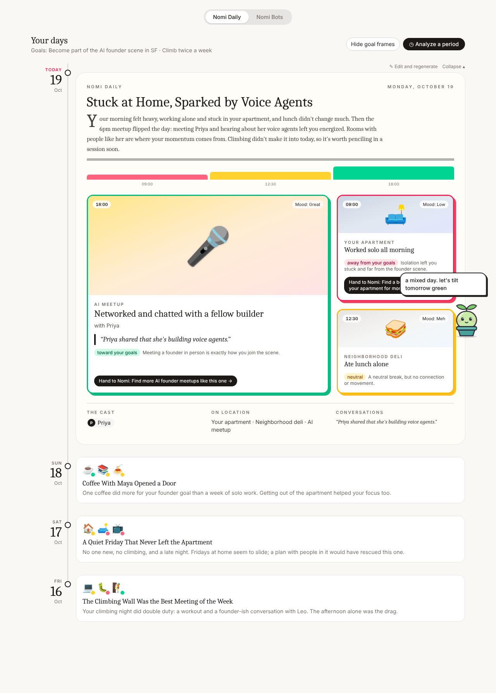
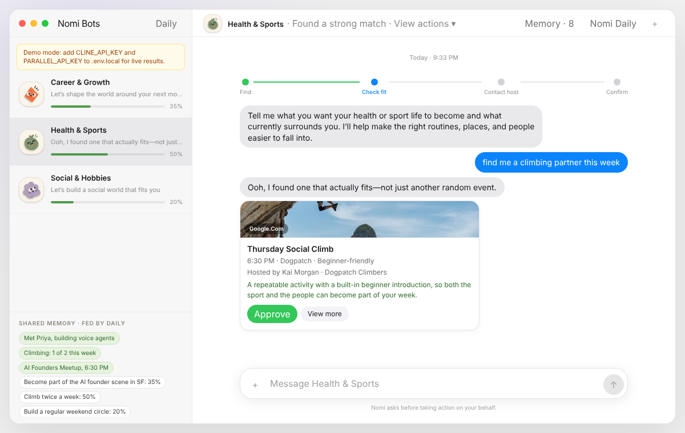
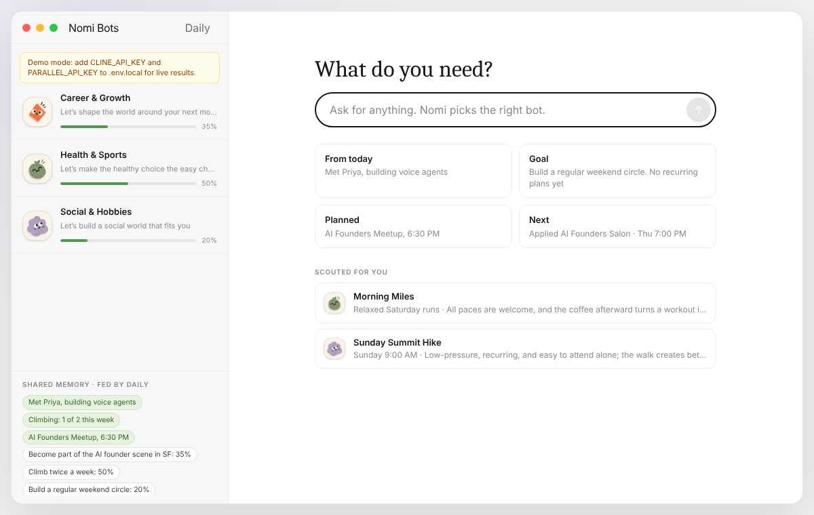
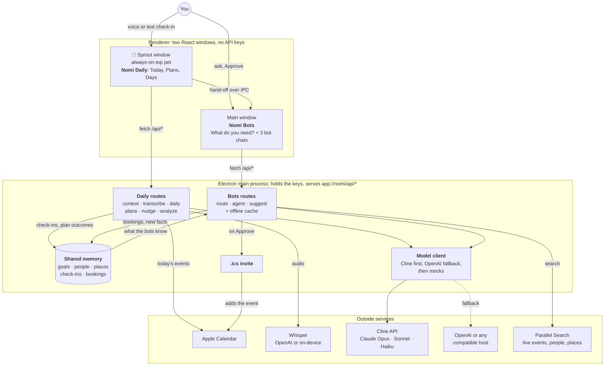
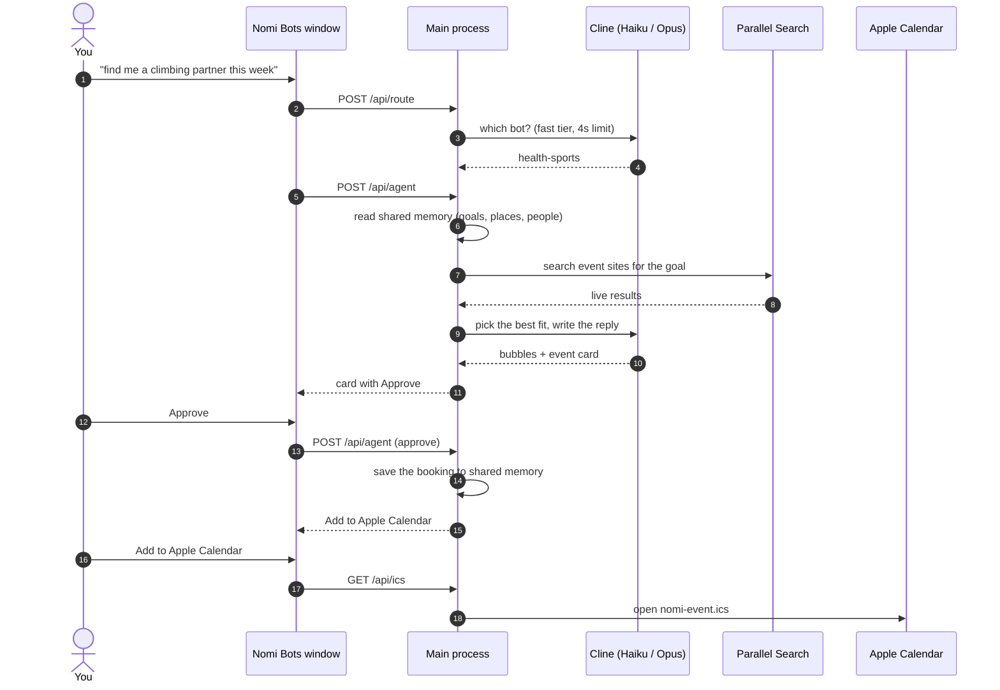

# Nomi 🌱

**The AI assistant for life beyond the screen.**

Most AI agents work on what happens on your screen: code, email, admin. But who you become depends on who you're around: the people you meet, the rooms you're in, the routines you keep. Nomi is an open-source desktop companion that helps you see how your surroundings shape your goals, then goes out on the live web to put better people, places and communities on your calendar, with your approval.

Built for the **Cline x Composio x Parallel Open Source AI Week** hackathon. MIT licensed.

| Nomi Daily: your day as a storyboard | Nomi Bots: live picks you approve |
|---|---|
|  |  |

## What it does

Nomi has two halves that share one memory: **Daily** helps you understand your environment, and **Bots** help you change it.

### 1. Sprout and Nomi Daily: reflect and understand

Sprout is a small plant that lives in the corner of your screen, always on top. Click it to open Nomi Daily.

- **Check in by voice or text.** Sprout starts from today's Apple Calendar events, then asks how the day went. Voice is transcribed with OpenAI or fully on your Mac with Whisper.
- **Get a magazine storyboard.** The model turns your day into a one-page spread: a headline, a summary, and a panel for each part of the day, framed **green** (toward your goals), **amber** (neutral) or **red** (away from them), plus the cast, places and conversations.
- **Make plans.** Say "I want to try Sightglass Saturday" and Nomi saves the plan. On the day, Sprout pops up with a nudge.
- **Watch Sprout grow.** Going through with a plan makes Sprout grow, skipping it makes Sprout wilt, and each day's storyboard nudges it up or down. The **Days** tab shows past storyboards, Sprout's health over time, and an analysis of any period that turns patterns into tasks for the bots.

### 2. Nomi Bots: connect and act

The main window holds three bots, each a friend with a lane:

| Bot | Shapes |
|---|---|
| 🚀 **Career & Growth** | founder rooms, mentors, collaborators, opportunities |
| ⚡ **Health & Sports** | training partners, clubs, classes, routines |
| 🎨 **Social & Hobbies** | communities, hobby groups, a regular weekend circle |

- **"What do you need?"** Type anything ("find me a climbing partner this week") and Nomi routes it to the right bot.
- **Live scouting with Parallel.** The bot searches the live web (Luma, Meetup, Partiful, Eventbrite and more), and the model picks the best fit and explains why in a friend's voice.
- **You approve, Nomi acts.** Tap **Approve**, then **Add to Apple Calendar**, and Nomi writes an `.ics` invite that drops the event into your calendar, with a link to the event page to request your spot.
- **Proactive suggestions.** Bots scout in the background from what they know about you, and Sprout pops the best one on your desktop.
- **Shared memory.** Your check-ins, plans, goals and bookings feed one memory that every bot reads, so a meetup you loved on Monday shapes what Career & Growth looks for next.



## How it works

Nomi is a pure Electron app. The React renderer draws two windows, and the Electron main process does every outside call, so API keys never reach the UI.



### One request, end to end



### Built to survive a live demo

- **Model tiers with fallback.** Cline serves Claude Opus 5.5 first and Sonnet 5.5 if it's slow or failing, with Haiku 5.5 for fast jobs like routing. OpenAI (or any OpenAI-compatible host) is the other side. Every call has a time limit, and if nothing answers, each route falls back to curated mock data.
- **Offline cache.** The last good live scout is saved to disk, so a dropped venue network still shows real results.
- **Approve before acting.** Nothing leaves your machine as an action until you tap Approve.

See [docs/ARCHITECTURE.md](docs/ARCHITECTURE.md) for every route, the shared memory, and how Daily hands work to the bots.

## How we used the sponsors

| | Role in Nomi |
|---|---|
| **[Cline](https://cline.bot)** | Built the app, and powers its brain: the Cline API serves Claude Opus, Sonnet and Haiku tiers for every Daily and Bots call. |
| **[Parallel](https://parallel.ai)** | Nomi's eyes on the world: the Search API finds live events, people and spaces on Luma, Meetup, Partiful and Eventbrite. |
| **Open models** | Swappable brain: set `CLINE_MODEL` (for example an open-weight model on Cline) or point `OPENAI_BASE_URL` at any OpenAI-compatible host, with no code change. |

## Run it

Requires Node 20+. Calendar reading and on-device Whisper need macOS; elsewhere Nomi uses a demo calendar.

```bash
npm install
cp .env.example .env.local   # optional: without keys everything runs on mock data
npm run desktop              # or `npm run dev` to rebuild on save
```

Keys go in `.env.local` and are read only by the main process:

| Variable | What it turns on |
|---|---|
| `CLINE_API_KEY` | Live model calls through Cline (default `anthropic/claude-opus-5.5`, fallback `anthropic/claude-sonnet-5.5`) |
| `OPENAI_API_KEY` | The OpenAI side for chat, and voice transcription |
| `PARALLEL_API_KEY` | Live scouting for the bots |
| `NOMI_CALENDARS` | Which Apple Calendars to read, comma-separated (each takes about a second) |
| `NOMI_DEMO_CALENDAR=1` | Use the demo calendar feed instead of your real one |

Sprout lives in the corner of your screen: drag it anywhere, click it to open Nomi Daily. The main window is Nomi Bots, opened from Sprout's panel, the 🌱 tray icon or the dock. Closing the main window keeps Sprout running; quit from the tray.

- **Calendar:** macOS asks once to let Nomi use Calendar. If it can't be read, Today says so rather than showing made-up events.
- **Voice:** uses `OPENAI_API_KEY` (`TRANSCRIBE_MODEL`, default `whisper-1`), or Whisper on your Mac after `npm run voice:setup` (Homebrew's whisper-cpp plus a 140 MB English model in `~/.nomi`). With neither, Sprout asks you to type.

### Demo controls

Right-click Sprout, use the tray menu, or press ⌥⌘ and a number with any app in front:

| Keys | Does |
|---|---|
| ⌥⌘1 | Ask the bots for a suggestion, popped by Sprout |
| ⌥⌘2 | Skip to the next plan's day: today's storyboard moves into Days, Sprout says good morning, and the plan nudge pops |
| ⌥⌘3 | Pop the reminder for your next plan right away |
| ⌥⌘0 | Start over: no check-ins, plans or health changes |

## Project layout

```
electron/main.ts            windows, tray, demo shortcuts, serves the app and /api/* on app://nomi
electron/preload.ts         the small bridge between the windows and the main process
electron/api/router.ts      maps /api/* to the handlers below
electron/api/context.ts     today's Apple Calendar events (or the demo feed)
electron/api/transcribe.ts  voice check-in audio -> text (OpenAI or local Whisper)
electron/api/daily.ts       day text + calendar -> magazine storyboard
electron/api/plans.ts       plans pulled from a check-in, and Sprout's nudge on the day
electron/api/analyze.ts     patterns across a range of days -> bot hand-offs
electron/api/memory.ts      the shared memory every bot reads
electron/api/triage.ts      the "What do you need?" router
electron/api/agent.ts       one bot turn: memory + Parallel + model -> cards and Approve
electron/api/suggestions.ts proactive scouting that Sprout pops
electron/api/live.ts        time limits and the offline cache for live calls
electron/api/ics.ts         calendar invites
src/PetWindow.tsx           Sprout's window: the pet, the Daily panel, nudges and suggestions
src/App.tsx                 the main window: Nomi Bots
features/daily/             Daily panel (Today, Plans, Days), storyboard, Sprout and its health
features/bots/              bot list, chat, milestone bars
lib/llm.ts                  model client with Cline and OpenAI sides
lib/parallel.ts             Parallel Search client
lib/calendar.ts             .ics builder
lib/types.ts                shared contracts
```

[docs/PLAN.md](docs/PLAN.md) has the scope and demo script, and [docs/WORKFLOW.md](docs/WORKFLOW.md) has how the team split the work.

## License

[MIT](LICENSE). Nomi is open source; fork it, run it, make it yours.
