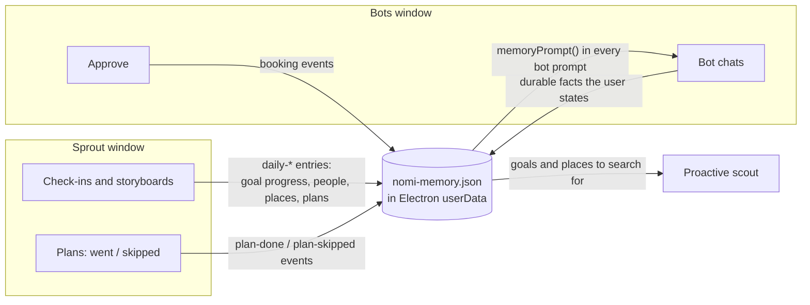

# Nomi architecture

Nomi is one Electron app with two windows and one main process. The windows are React and never hold an API key; everything that talks to the outside world runs in the main process.

## Processes and windows

| Piece | Code | Job |
|---|---|---|
| Main process | `electron/main.ts` | Creates both windows and the 🌱 tray, registers the ⌥⌘ demo shortcuts, loads `.env.local`, and serves the built renderer plus `/api/*` on the private `app://nomi` scheme. |
| Preload bridge | `electron/preload.ts` | Exposes `window.nomi` for window chores only: move Sprout, resize its window, open Daily or Bots, pass a hand-off. |
| Sprout window | `src/PetWindow.tsx`, `features/daily/` | Transparent, frameless and always on top. Shows the pet, and grows to show the Daily panel, a plan nudge, or a bot suggestion. |
| Main window | `src/App.tsx`, `features/bots/` | Nomi Bots: the "What do you need?" box, three bot chats, and the shared memory sidebar. Hidden until opened from Sprout, the tray or the dock. |

The renderer calls `fetch("/api/...")` like a web app. Because the page is served from `app://nomi`, those requests land in `electron/api/router.ts` inside the main process, which is where the keys live.

## API routes

| Route | Handler | What it does | Outside calls |
|---|---|---|---|
| `GET /api/context` | `context.ts` | Today's Apple Calendar events, read with `osascript` (JXA), cached for a minute. Demo feed off a Mac or with `NOMI_DEMO_CALENDAR=1`. | Apple Calendar |
| `POST /api/transcribe` | `transcribe.ts` | Voice check-in audio (16 kHz WAV) to text. | OpenAI transcription, else local `whisper-cli` |
| `POST /api/daily` | `daily.ts` | Day text plus calendar to a storyboard: headline, summary, 3 to 6 segments scored -1/0/+1 against your goals, and bot hand-offs. | Model |
| `POST /api/plans` | `plans.ts` | Pulls future plans ("Sightglass Saturday") out of a check-in. | Model, with a local parser fallback |
| `POST /api/plans/nudge` | `plans.ts` | Sprout's cheer on the day of a plan. | Model |
| `POST /api/daily/analyze` | `analyze.ts` | Patterns across a range of days, turned into insights and bot hand-offs. | Model |
| `GET/POST /api/memory` | `memory.ts` | Reads and updates the shared memory. | none |
| `POST /api/route` | `triage.ts` | Picks the bot for a "What do you need?" request. Keyword routing if the model is slow. | Model (fast tier, 4s) |
| `POST /api/agent` | `agent.ts` | One bot turn, and the Approve step. | Parallel, model |
| `POST /api/suggest`, `POST /api/suggestions` | `suggestions.ts` | Proactive scouting per bot; Sprout pops the best pick. Re-scouts at most every 15 minutes. | Parallel, model |
| `GET /api/bots/status` | `live.ts` | Whether the Cline and Parallel keys are set (or malformed), for the demo-mode banner. | none |
| `GET /api/ics` | `ics.ts` | Builds a calendar invite. The main process writes it to a temp file and opens it in Apple Calendar. | Apple Calendar |

## Shared memory

The store lives in the main process (`electron/api/memory.ts`) as JSON under Electron's `userData`, so both windows and the scout see the same thing. It holds:

- **items**: durable facts (goal, person, community, place, preference, constraint, commitment). Daily owns the ones whose id starts with `daily-` and replaces them on each check-in; bots add the rest.
- **goals**: progress per goal, each tied to a bot.
- **events**: a short feed of what just happened (plans kept or skipped, bookings).

On first launch it's seeded with the demo persona from `docs/PLAN.md`, so the bots already know the user.

## Daily to Bots hand-offs

A storyboard panel or a period analysis can carry action items ("Find more AI founder meetups like this one"). Tapping one calls `window.nomi.openBots(item)`; the main process shows the Bots window and sends the item over IPC (`nomi:handoff`), and the matching bot starts a turn with it as context.

## Model client

`lib/llm.ts` is a small OpenAI-compatible client with named sides, tried in order until one answers:

1. **Cline** (`CLINE_API_KEY`): `anthropic/claude-opus-5.5` by default, then `anthropic/claude-sonnet-5.5`. Routing uses `anthropic/claude-haiku-5.5` for speed. `CLINE_MODEL` swaps in any model Cline serves, including open-weight ones.
2. **OpenAI** (`OPENAI_API_KEY`, `OPENAI_MODEL`, optional `OPENAI_BASE_URL` for any compatible host).
3. **Custom** (`LLM_BASE_URL`, `LLM_API_KEY`, `LLM_MODEL`).

`LLM_PROVIDER` picks the first side; `DAILY_LLM_PROVIDER` overrides it for Daily. Each attempt has a time limit (45s by default) before the next side takes over. If every side fails or none is set, each route returns curated mock data, so the app always runs.

## Live calls on a flaky network

`electron/api/live.ts` wraps every Parallel and model call in a time limit and saves the last good live answer to `nomi-live-cache.json`. When the network drops on stage, the bots show those saved real results instead of hanging.

## Safety

- API keys are read only by the main process. Keys pasted with stray characters (like a copied `•` mask) are dropped with a clear message instead of crashing a request.
- Every outward action waits for an explicit **Approve**. Nomi can't register you for someone else's event, so it holds the time in your calendar and links to the event page to request your spot.
